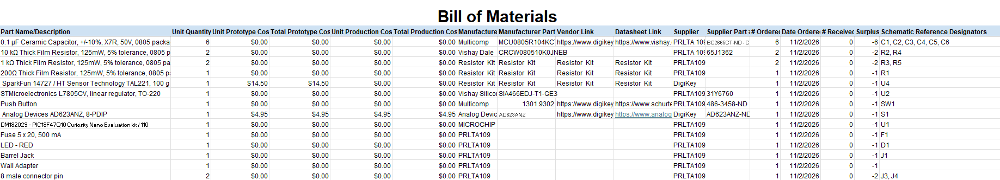

## Overview
The bill of materials covers the weight sensing board: a TAL221 100 g load cell feeds an AD623 instrumentation amplifier, a PIC Curiosity Nano reads the signal, and the board is powered from a wall adapter through a barrel jack, a 500 mA fuse and an L7805CV 5 V regulator. The prototype will roughly cost of $19.45. Most other parts come from lab stock at $0, and everything was ordered on 11/2/2026 but not yet received.

## Bill of Materials Example 

**Figure 2:** Example Bill of Materials as a screenshot.

