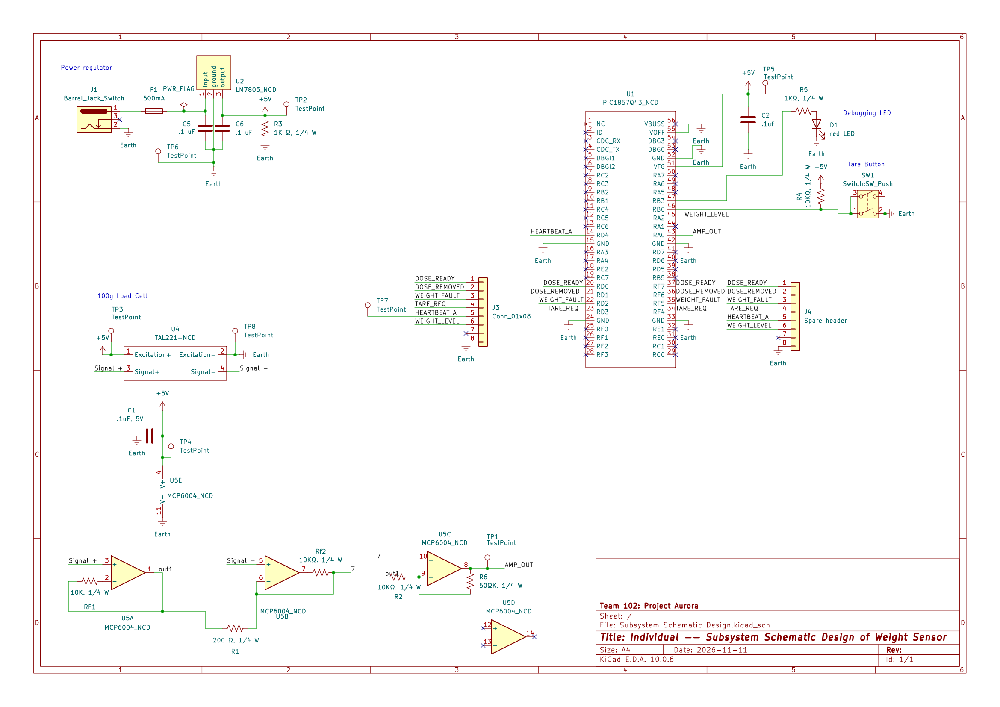

## Overview

The schematic was designed to support the weight-sensing portion of the overall system. The subsystem uses a TAL221 load cell to detect changes in weight and a MCP6004 instrumentation amplifier. An anaglog signal is then sent to the PIC18F57Q43 Curiosity Nano, where it can be processed and used to determine the current weight.

Power enters the subsystem through a DC barrel jack and passes through a 500 mA fuse. An L7805 voltage regulator provides the regulated 5 V. Bypass capacitors are included to improve power stability, and an LED provides a visual indication that the subsystem is receiving power.

The Curiosity Nano also communicates with the other subsystems through signals including DOSE_READY, DOSE_REMOVED, WEIGHT_FAULT, TARE_REQ, HEARTBEAT_A, and WEIGHT_LEVEL. A backup header provides additional access to troubleshooting if something goes wrong. Test points were also incorporated throughout the design to ensure that the circuit is properly working.

{style width:"350" height:"300;"}
**Figure 2:** Showing weight sensor schematic.

## Resouces

The schematic as a PDF download is available [*here*](SubsystemSchematicDesign2.pdf), and the Zip folder of the project [*here*](NataliaCastillo-Diaz102.zip).
 
