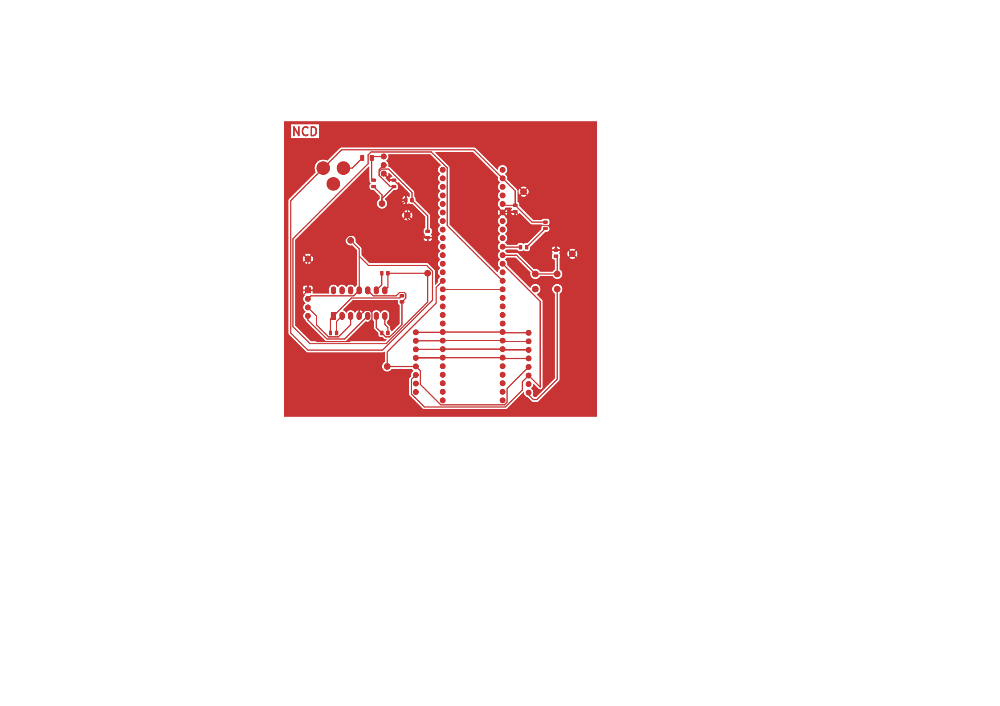
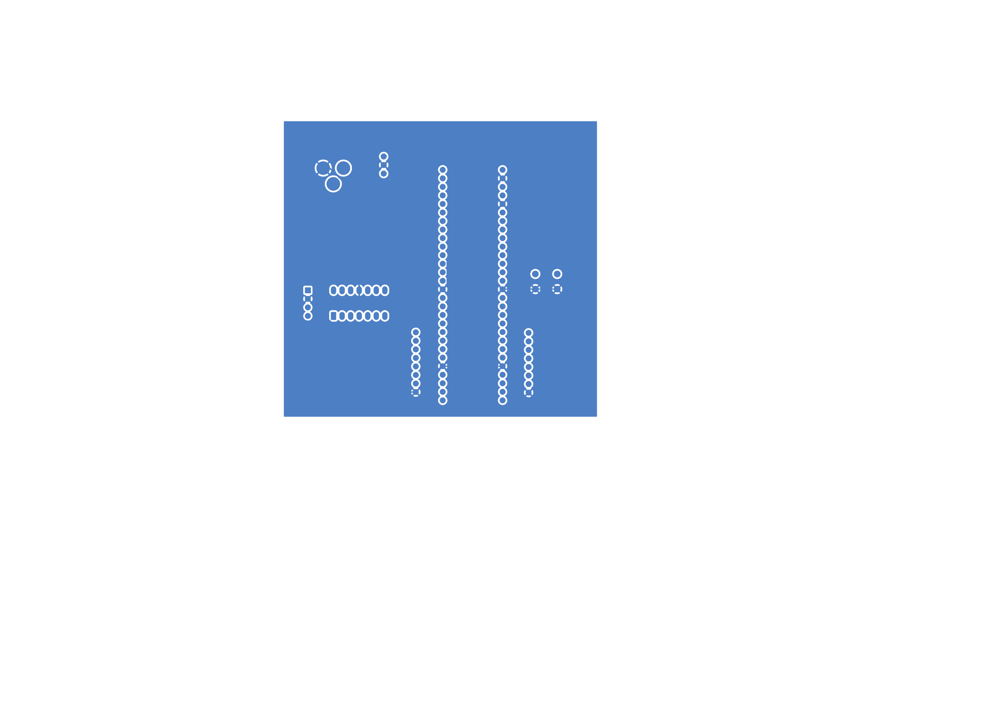

## Overview

The weight sensing board is the load-cell measurement subsystem for Team 102’s Project Aurora. It is a two-layer FR-4 board designed to the Peralta Engineering Studio mill specifications (15 mil minimum signal traces, 40 mil power and ground traces, 10 mil clearances, and 15 mil minimum annular rings). A 9 V wall adapter plugs into barrel jack J1, passes through fuse F1, and is regulated to 5 V by the LM7805 (U2), with decoupling capacitors on the input and output. The 5 V rail powers the TAL221 load cell (U4) and the MCP6004 instrumentation amplifier (U3), which amplifies the load cell’s small differential signal. The result goes through an RC low-pass filter to a PIC18F57Q43 Curiosity Nano (U1), which digitizes the weight and handles the tare button (SW1). An 8-pin header (J3) connects the board to the Hub and carries the DOSE_READY, DOSE_REMOVED, WEIGHT_FAULT, TARE_REQ and HEARTBEAT_A digital signals, the WEIGHT_LEVEL analog output, and ground. A second 8-pin header (J4) and test points TP1 to TP8 give access for debugging and calibration. Ground (Earth) is poured on the back copper layer, and the +5V rail uses wide traces and a front-layer pour to keep resistance low.

{style width:"350" height:"300;"}
**Figure 6:** Showing weight sensor schematic.

{style width:"350" height:"300;"}
**Figure 7:** Showing front of weight sensor PCB.

{style width:"350" height:"300;"}
**Figure 7:** Showing back of weight sensor PCB.
## Resouces

The schematic as a PDF download is available [*here*](NataliaCastillo-DiazPCB.pdf), the Gerber Zip folder of the project [*here*](Gerber.zip), e Gerber Zip folder of the project [*here*](Gerber.zip).
 
.
 
